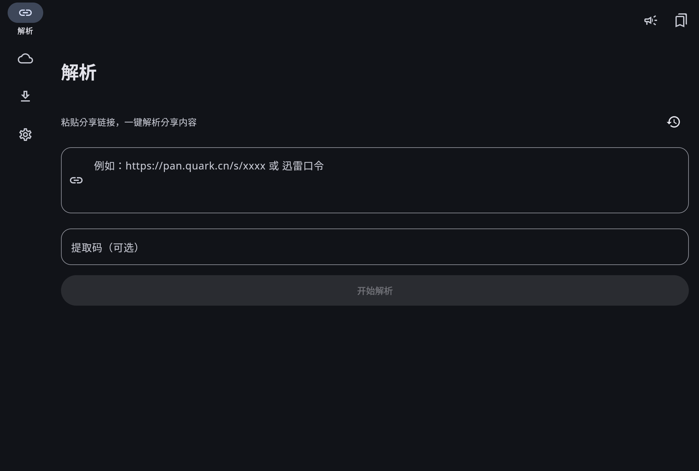
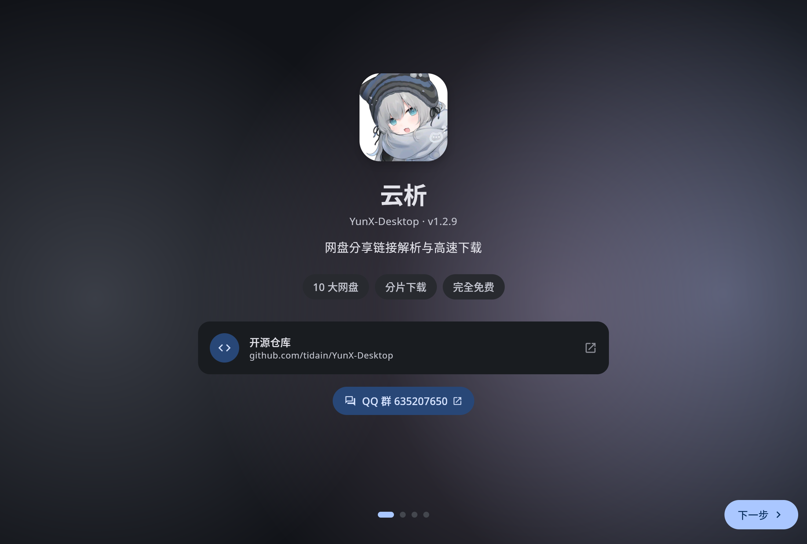

<div align="center">


# 云析桌面版 · Linux 移植

**粘贴分享链接，直接高速下载 —— 云析 YunX 的 Linux 桌面版**

识别夸克 / UC / 迅雷 / 百度 / 139 / 123 分享链接，自动匹配提取码，Range 分片并发 + 断点续传。

[](./LICENSE)
[](#安装)
[](https://kotlinlang.org/)
[](https://www.jetbrains.com/lp/compose-multiplatform/)

[下载最新版](https://github.com/FairyJJ/yunx-desktop-linux/releases/latest) · [安装](#安装) · [Linux 平台实现](#linux-平台实现) · [已知限制](#已知限制) · [从源码构建](docs/BUILD-LINUX.md) · [改动清单](PORT-LINUX.md)

</div>

***

> ### 这是非官方的 Linux 移植版
>
> - **上游（安卓）**：[CYQawa/YunX](https://github.com/CYQawa/YunX)
> - **上游（Windows 桌面）**：[tidain/YunX-Desktop](https://github.com/tidain/YunX-Desktop) v1.2.9 —— 本项目的直接基座
> - **本仓库**：`FairyJJ/yunx-desktop-linux`，2026-10-18 起由 FairyJJ 修改，**仅新增/修改 Linux 平台相关代码**，业务逻辑未改动
>
> 上游作者不提供 Linux 支持，Linux 相关问题请提到**本仓库** Issues，不要去打扰上游。
> 完整的修改清单见 **[PORT-LINUX.md](PORT-LINUX.md)**，第三方组件与版权归属见 **[NOTICE](NOTICE)**。

> **云析永远免费开源。** 如果你是在任何地方「花钱买到」的，说明你被骗了，请立即退款。
> 任何收费版本均为二次打包的诈骗版本，与本项目及上游均无关。

## 截图

|                                                                    |                                                                          |
| :----------------------------------------------------------------: | :----------------------------------------------------------------------: |
|  |  |
|                                主界面（GNOME / 深色）                                 |                                 引导页                                 |

> 截图取自 EndeavourOS + GNOME 49（Wayland）、2× HiDPI 实机运行。

## 安装

### Arch / Manjaro / EndeavourOS（推荐）

```bash
# 从 Releases 下载后
sudo pacman -U yunx-desktop-1.2.9-1-x86_64.pkg.tar.zst
yunx-desktop        # 或应用菜单搜「云析」
```

装到 `/opt/yunx-desktop`（**自带 jlink 精简 JRE，不依赖系统 JDK**），并注册
`/usr/bin/yunx-desktop`、桌面项与图标。

### 其他发行版（便携包）

```bash
tar -xzf YunX-Desktop-1.2.9-linux-x86_64.tar.gz
./YunX-Desktop/bin/YunX-Desktop
```

便携包解压即用，目录可任意放置；需要系统具备常见图形库（见下方「运行依赖」）。

### 运行依赖

| 依赖                                       | 用途                          |
| ---------------------------------------- | --------------------------- |
| `gtk3` `nss` `libxkbcommon` `libdrm` `mesa` | Chromium（JCEF）与 UI        |
| `libxtst` `libxrender` `fontconfig` `freetype2` `alsa-lib` | AWT 输入、字体、音频              |
| `libnotify`（可选）                          | 桌面通知与下载进度条                 |
| `systemd`（可选）                            | `systemd-inhibit` 下载时禁止休眠  |
| 文件管理器（可选，`nautilus`/`dolphin`/`thunar`…） | 「在文件管理器中显示」                |

## Linux 平台实现

上游把平台能力写成 Windows 专属（JNA + Win32 + PowerShell），移植时**逐个补了 Linux 真实现**，没有用空实现糊过去：

| 能力     | 上游（Windows）                    | 本仓库（Linux）                                                                                      |
| ------ | ------------------------------- | ----------------------------------------------------------------------------------------------- |
| 托盘右键菜单 | JNA `TrackPopupMenuEx`          | AWT `PopupMenu`                                                                                 |
| 桌面通知   | PowerShell + WinRT toast        | `notify-send`（`x-canonical-private-synchronous` 原地刷新 + `int:value` 进度）                          |
| 下载防休眠  | `SetThreadExecutionState`       | `systemd-inhibit --what=idle:sleep`                                                             |
| 定位文件   | `explorer.exe /select,`         | `org.freedesktop.FileManager1.ShowItems` → 回退 `xdg-open`                                       |
| 打开文件/目录 | `explorer.exe`                  | `xdg-open`                                                                                      |
| 重启应用   | `cmd /c ping & start`           | `sh -c 'sleep 2; exec <launcher>'`                                                              |
| 系统暗色   | 注册表 `AppsUseLightTheme`        | `gsettings color-scheme` → `gtk-theme` 含 dark → `GTK_THEME`                                      |
| 系统代理   | 注册表 `Internet Settings`        | `http_proxy`/`https_proxy`/`all_proxy` 环境变量 → `gsettings org.gnome.system.proxy`               |
| 数据目录   | `%LOCALAPPDATA%`                | `XDG_DATA_HOME`（默认 `~/.yunx-desktop`）                                                          |
| 下载目录   | `USERPROFILE\Downloads`         | `XDG_DOWNLOAD_DIR`（`xdg-user-dir DOWNLOAD`，中文系统即 `~/下载`）                                      |
| 数据库密钥绑定 | `MachineGuid`（注册表）             | `/etc/machine-id`                                                                               |
| 下载内核   | `gopeed-web-<ver>-windows-amd64` | `gopeed-web-<ver>-linux-amd64.zip`，解包后补执行位                                                    |

数据目录：`~/.yunx-desktop/`（`yunx.db`、`credential.key`、日志、JCEF 缓存）。

## 已知限制

1. **一键导入本机浏览器 Cookie 不可用**（Linux）—— 上游走 Windows DPAPI 解密 Chromium 的 `encrypted_value`；
   Linux 需接 libsecret + AES-256-GCM（`v10` 前缀）才能解，本次未实现，界面会显示「未检测到浏览器」。
   **内嵌浏览器登录、手动粘贴 Cookie 均正常**，主流程不受影响。
2. **「较为严格」数据库加密档置灰** —— 它依赖 DPAPI，Linux 无等价物。与其让你切过去解不开凭证，不如直接标不可用。
3. **仅 x86_64** —— 未提供 aarch64 构建（JCEF 原生库另需对应平台包）。
4. **首次启动会解包 JCEF 约 325 MB** 到 `~/.yunx-desktop/cache/jcef-bundle`，之后启动不再重复。
5. **界面走 XWayland** —— Compose Desktop + JCEF 在 Wayland 会话下通过 XWayland 运行（GNOME 下实测正常）。
   HiDPI 缩放下若窗口元素比例异常，可设 `GDK_SCALE` / `JAVA_TOOL_OPTIONS=-Dsun.java2d.uiScale=1`。
6. **GNOME 托盘图标默认不显示** —— GNOME 无内置托盘，需装 [AppIndicator 扩展](https://extensions.gnome.org/extension/615/appindicator-support/)。
   未装时「最小化到托盘」会退化为最小化到任务栏，不会让窗口消失后无法恢复。

## 从源码构建

见 **[docs/BUILD-LINUX.md](docs/BUILD-LINUX.md)**（JDK 17 + Gradle Wrapper，无需 Windows 工具链）：

```bash
# 1) 生成自带运行时的 app-image
./gradlew :desktop:createDistributable -Dorg.gradle.java.home=/usr/lib/jvm/java-17-openjdk

# 2) 打 pacman 包
cd packaging && makepkg -f
```

## 卸载

```bash
sudo pacman -Rns yunx-desktop     # Arch
rm -rf ~/.yunx-desktop            # 连账号、任务、JCEF 缓存一起清
```

## 开源协议

本项目是 [tidain/YunX-Desktop](https://github.com/tidain/YunX-Desktop) 的衍生作品，
而后者又基于 [CYQawa/YunX](https://github.com/CYQawa/YunX) 移植。三者同样以
**[GNU AGPL-3.0](https://www.gnu.org/licenses/agpl-3.0.html)** 发布，全文见 [LICENSE](LICENSE)。

- **修改声明**：本仓库自 2026-10-18 起由 FairyJJ 修改以支持 Linux，修改范围见 [PORT-LINUX.md](PORT-LINUX.md)。
- **源码获取**：本仓库即对应源码；每个 Release 附带可运行的二进制，对应源码为**同一 tag 的完整仓库**
  （GitHub 自动提供 `Source code (zip/tar.gz)`）。打包脚本、`PKGBUILD`、桌面项均在仓库内，可完整复现构建。
- **不捆绑第三方 GPL 程序**：下载内核 Gopeed（GPL-3.0）不随本仓库或安装包分发，由程序在首次使用时
  从 [GopeedLab/gopeed](https://github.com/GopeedLab/gopeed) 官方 Release 下载。
- 完整的免责与合规说明见上游 [docs/DISCLAIMER.md](docs/DISCLAIMER.md)，补充条款见 [NOTICE](NOTICE)。

## 更多

- 上游安卓项目：<https://github.com/CYQawa/YunX>
- 上游 Windows 桌面移植：<https://github.com/tidain/YunX-Desktop>
- 上游 README 原文（保留备查）：[README-UPSTREAM.md](README-UPSTREAM.md)
